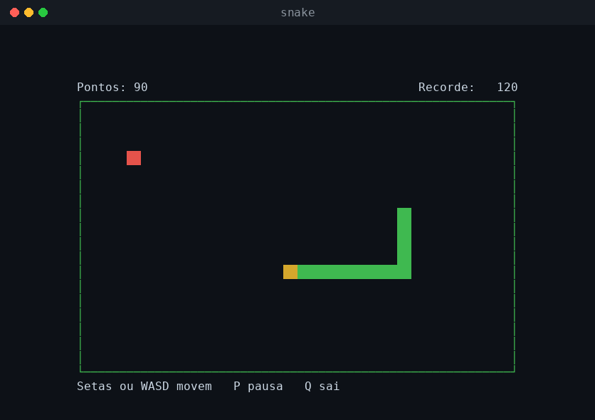

# 🐍 Snake no Terminal

O clássico jogo da cobrinha, rodando direto no terminal com a biblioteca **ncurses**. A cobra anda sozinha, cresce a cada comida, fica mais rápida conforme você avança e o recorde fica salvo em arquivo.



## Funcionalidades

- **Controles:** setas ou **W A S D** para mover, **P** ou espaço para pausar, **Q** para sair
- **Fica mais rápido** a cada 3 comidas, até uma velocidade máxima
- **Recorde salvo** no arquivo `.snake-recorde`, na sua pasta pessoal
- **Teclas rápidas não matam a cobra:** duas curvas digitadas no mesmo instante (como ↑ e ←) são guardadas e feitas uma por vez, e uma meia-volta escondida (↑ e ↓) é recusada
- **Tabuleiro ajustado** ao tamanho do terminal
- **Telas de início, pausa e fim de jogo**, com opção de jogar de novo

## Estrutura

```
snake/
├── include/
│   ├── jogo.h         # Regras: cobra, comida, colisões, velocidade
│   └── recorde.h
├── src/
│   ├── main.c         # Tela e teclado (ncurses)
│   ├── jogo.c         # Lógica do jogo, sem nada de tela
│   └── recorde.c      # Leitura e gravação do recorde
├── tests/
│   └── test_jogo.c    # 26 testes das regras
├── docs/
│   └── preview.png
├── Makefile
└── README.md
```

## Dependências

- GCC (ou Clang) e `make`
- Biblioteca **ncurses**:
  - **Ubuntu/Debian/WSL:** `sudo apt install libncurses-dev`
  - **macOS:** já vem instalada
  - **Windows:** use o [WSL](https://learn.microsoft.com/pt-br/windows/wsl/install), ou o MSYS2 com o pacote `ncurses`

## Como compilar e executar

```bash
cd snake
make
./bin/snake
```

O terminal precisa ter pelo menos 26 colunas por 12 linhas. Para rodar os testes das regras:

```bash
make test
```

## Como funciona

**Corpo da cobra como fila circular.** As posições do corpo ficam em uma fila: a cada passo, a nova cabeça entra no fim e a cauda sai do começo. Quando a cobra come, a cauda não sai, e é assim que ela cresce. Com o vetor circular, cada passo custa O(1), sem deslocar o corpo inteiro.

**Lógica separada da tela.** O arquivo `jogo.c` não sabe nada sobre o ncurses: ele só recebe comandos (`jogo_virar`, `jogo_passo`) e atualiza o estado. Isso permite testar as regras com `make test`, sem abrir o jogo.

**Laço de jogo com tempo fixo.** O programa espera teclas apenas até a hora do próximo passo (`timeout` do ncurses + `clock_gettime`). Assim a cobra anda no mesmo ritmo, não importa quantas teclas você aperte.

**Comida sempre em lugar livre.** Em vez de sortear qualquer casa e tentar de novo se cair na cobra, o jogo sorteia entre as casas livres. Funciona mesmo com a cobra quase enchendo o tabuleiro.

**Detalhe da colisão.** A cauda sai antes de verificar se a cabeça bateu no corpo. Assim, a cabeça pode entrar na casa que a cauda acabou de deixar, como no jogo original.

## Conceitos praticados

Biblioteca ncurses (cores, `timeout`, teclas especiais), laço de jogo (*game loop*), fila circular, separação entre lógica e interface, gerador de números aleatórios próprio (LCG), leitura e escrita de arquivo, testes automatizados.
